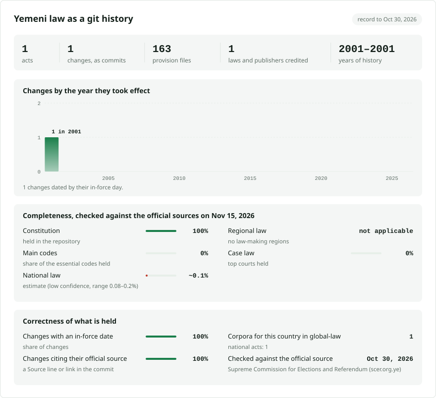

# Yemen: law history in git

[العربية](README.md) · **English**

<picture>
<source media="(prefers-color-scheme: dark)" srcset="data/effort-dark.svg">

</picture>

The law of Yemen as a git history: one file per article, one commit per version on the day it took effect, and the law that made each change as the commit's author. `git blame` names the law behind every article; `git log` lists every change to an article; picking a date gives the text in force that day.

Part of [lexifina/global-law](https://github.com/lexifina/global-law), one git history for every country's law: this is Yemen's national law, which global-law reads at `yemen/national/acts/`.

**What is in it now:** the Constitution of the Republic of Yemen (دستور الجمهورية اليمنية) as amended in 2001, in one version: 162 articles. No statute is here yet. [`REPRODUCE.md`](REPRODUCE.md) lists the act with its version and says how the files were made; [`constitution/README.md`](constitution/README.md) lists its articles.

The Constitution is a folder, one file per article: `constitution/art-001.md` is Article 1 (مادة (1)), and so on to `constitution/art-162.md`.

The text is in Arabic, the official language, as the Supreme Commission for Elections and Referendum (SCER) printed it. An English translation is not part of this record.

## Questions as git commands

| Question | Command |
| --- | --- |
| Every change to Article 1 of the Constitution | `git log -p --word-diff -- constitution/art-001.md` |
| Which law wrote each line of Article 1? | `git blame constitution/art-001.md` |
| Every version of the Constitution, with the day each took effect | `git log --format="%h %(trailers:key=In-force,valueonly,separator=) %an" -- "constitution/art-*"` |
| Article 1 as in force on 1 January 2024 | `python tools/on.py 2024-01-01 constitution art-001` |

**Outside git**, we also host this record publicly, for free:

- **[Ask Claude about Yemeni law](https://global-law.lexifina.com/v1/try_claude?country=yemen)**: opens Claude with a first question ready.
- **[Ask ChatGPT](https://global-law.lexifina.com/v1/try_chatgpt?country=yemen)**: the same question in ChatGPT.
- **[Search Yemeni law on our site](https://lexifina.com/law?country=yemen&q=%D8%A7%D9%84%D8%AA%D8%B9%D9%84%D9%8A%D9%85)**: a search for "التعليم" (education), with each provision's text and its versions, no account needed.
- **[Developer REST API](https://global-law.lexifina.com/v1/search_law?query=%D8%A7%D9%84%D8%AA%D8%B9%D9%84%D9%8A%D9%85&jurisdiction=yemen)**: the same search as JSON, with no key. See the [documentation here](https://lexifina.com/api/global-law).

Both assistants read the record through the free Global law connector (MCP, `https://global-law.lexifina.com/mcp`); the first time, the chat gives you the link that adds it. Ask in Arabic or in English.

**Host it yourself easily.** All it takes is git and Python, and the tools run on your machine:

```sh
git clone --depth 1 https://github.com/lexifina/global-law && cd global-law
python3 tools/countries.py add yemen/national/acts
python3 tools/law.py show 2026-01-01 yemen/national/acts/constitution/art-001.md
```

Opened in Claude Code, Cursor, VS Code or Codex, the clone also starts a local MCP server with the same tools ([MCP.md](https://github.com/lexifina/global-law/blob/main/MCP.md)).

## Dates

Each commit is dated at noon, Asia/Aden, on the day the version took effect, and carries it in its `In-force:` trailer:

- the Constitution's one version is dated 28 February 2001, the date SCER gives for the referendum on the 2001 amendments; the source gives no earlier version as text;
- under Article 156 of the 1994 text, as SCER quotes it, an amendment approved by referendum takes effect when the result is announced; that day is not printed in the sources read, so the referendum date stands in for it.

The text is the oldest version available and is credited to the publisher, `Supreme Commission for Elections and Referendum (scer.org.ye)` (`Kind: publisher`), not to a law; its commit message names the laws that produced it, the Constitution of 1991 and the amendments of 1994 and 2001 ([`data/laws.csv`](data/laws.csv)). The committer is Lexifina.

## How it is checked

- `tools/check_repo.py` reads every version back from git on the day it took effect and on the day before and compares it with the corpus, whose hash is in `data/corpus.sha256`; it also checks that every commit's trailers parse, that `main` has no merge commits and that no commit is dated in the future. [`REPRODUCE.md`](REPRODUCE.md) does not record a result for this build yet.
- `tools/build.py` writes the history from that one corpus file, and the same corpus gives the same commit hashes; no second build has been compared yet.
- All 162 articles were cross-checked against an independent 2011 Internet Archive capture of the same SCER pages.
- The wording is not corrected: only the Arabic tatweel (letter stretching), zero-width and direction marks are removed and spacing is collapsed.
- [vulnerabilities/](vulnerabilities/README.en.md): possible drafting mistakes in this law, found by global-law's detectors and checked by hand. Not run yet.

## What it does not show

- **Earlier versions.** The Constitution of 1991 and the text as amended in 1994 are not built: SCER's table of the 2001 amendments gives old and new wording, but the 2001 amendments renumbered the articles from 35 on, and the old texts of the deleted articles 119 and 158 are not given.
- **The day the 2001 amendments took effect**, the announcement of the referendum result (see Dates).
- **Later changes.** The text is SCER's as captured in 2002 and 2003; a change after that would not show here.
- **Statutes.** No Yemeni law other than the Constitution is here yet.
- **Headings.** Part, chapter and section headings are left out.

## Sources

| Source | Kind | Past versions | Notes |
| --- | --- | --- | --- |
| [Supreme Commission for Elections and Referendum](https://web.archive.org/web/20021015030929/http://www.scer.org.ye:80/arabic/dstora.htm) (SCER), via the Internet Archive | The Constitution, official Arabic text (web pages) | no, the 2001 text only | All 162 articles; its [table of the 2001 amendments](https://web.archive.org/web/20021211003634/http://www.scer.org.ye:80/arabic/constadma.htm) gives the referendum date and Article 156 |
| [House of Representatives](https://web.archive.org/web/20031121155623/http://www.parliament.gov.ye/dostoor/index.htm), via the Internet Archive | The Constitution (web pages) | no | Articles 1 to 61 only; cites SCER as its source; used to cross-check |

## Licence

See [`LICENSE`](LICENSE). Yemen's Law No. 15 of 2012 on Copyright and Related Rights excludes official documents, such as the texts of laws, from protection; the text is published on that basis and will be withdrawn on request. Lexifina's own contributions (the history, commit messages, tables and tools) are CC0 1.0.

No AI model wrote, translated or corrected legal text; the scripts were written by an AI model, and no model runs when the history is built (see [`REPRODUCE.md`](REPRODUCE.md)).

## Visualisations

- [visualisations/](visualisations/README.en.md): charts drawn from this repository. Not drawn yet.

## More

From [lexifina/global-law](https://github.com/lexifina/global-law):

- [FEATURES.md](https://github.com/lexifina/global-law/blob/main/FEATURES.md): every feature, and what every corpus must support (`git blame`, `law.py`, the MCP tools)
- [FAQ.md](https://github.com/lexifina/global-law/blob/main/FAQ.md): questions and answers · [CONTRIBUTING.md](https://github.com/lexifina/global-law/blob/main/CONTRIBUTING.md): proposing changes · [MCP.md](https://github.com/lexifina/global-law/blob/main/MCP.md): the MCP server · [REPRODUCE.md](https://github.com/lexifina/global-law/blob/main/REPRODUCE.md): how it was built · [CHANGELOG.md](https://github.com/lexifina/global-law/blob/main/CHANGELOG.md)
- [FRESHNESS.md](https://github.com/lexifina/global-law/blob/main/FRESHNESS.md): how current each corpus is · [Monitoring](https://github.com/lexifina/global-law/tree/main/monitoring): whether updates are running · [WATCHING.md](https://github.com/lexifina/global-law/blob/main/WATCHING.md): how each official source is watched for changes
- [performance/](https://github.com/lexifina/global-law/tree/main/performance): how fast the tools are, measured
- [visualisations/](https://github.com/lexifina/global-law/tree/main/visualisations): charts and bridges across the world's law
- [Vulnerabilities](https://github.com/lexifina/global-law/tree/main/vulnerabilities): mistakes in legislation as published
