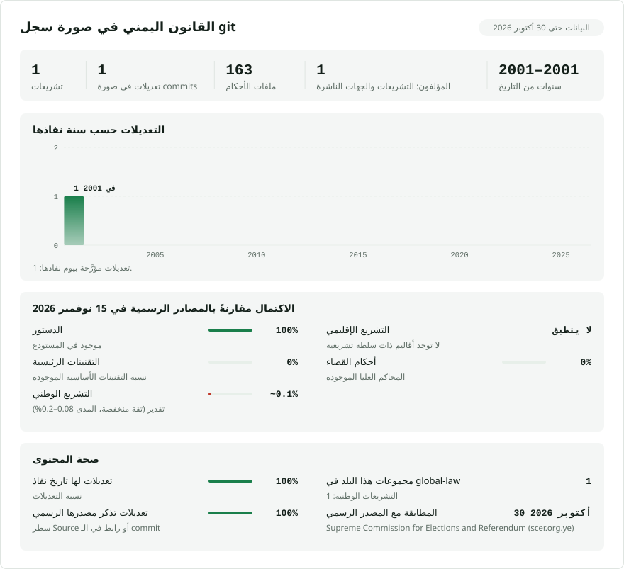

# اليمن: تاريخ القانون في git

**العربية** · [English](README.en.md)

<picture>
<source media="(prefers-color-scheme: dark)" srcset="data/ar/effort-dark.svg">

</picture>

القانون اليمني في صورة سجل git: ملف واحد لكل مادة، وcommit واحد لكل نسخة في يوم نفاذها، والقانون الذي أجرى كل تعديل هو مؤلف الـ commit. يذكر `git blame` القانون الذي يقف وراء كل مادة؛ ويسرد `git log` كل تعديل طرأ على مادة ما؛ واختيار تاريخ ما يعطي النص النافذ في ذلك اليوم.

جزء من [lexifina/global-law](https://github.com/lexifina/global-law)، وهو سجل git واحد لقوانين جميع الدول: هذا هو القانون الوطني اليمني، الذي يقرؤه global-law في `yemen/national/acts/`.

**ما يحتويه الآن:** دستور الجمهورية اليمنية بصيغته المعدَّلة في 2001، في نسخة واحدة: 162 مادة. ولا يوجد هنا بعدُ أي قانون. يسرد [`REPRODUCE.md`](REPRODUCE.md) التشريع مع نسخته ويبيّن كيف أُعدّت الملفات؛ ويسرد [`constitution/README.md`](constitution/README.md) مواده.

الدستور مجلد، فيه ملف واحد لكل مادة: `constitution/art-001.md` هي المادة 1 (مادة (1))، وهكذا حتى `constitution/art-162.md`.

النص باللغة العربية، اللغة الرسمية، كما طبعته اللجنة العليا للانتخابات والاستفتاء. والترجمة الإنجليزية ليست جزءًا من هذا السجل.

## الأسئلة بصيغة أوامر git

| السؤال | الأمر |
| --- | --- |
| كل تعديل طرأ على المادة 1 من الدستور | `git log -p --word-diff -- constitution/art-001.md` |
| أي قانون كتب كل سطر من المادة 1؟ | `git blame constitution/art-001.md` |
| كل نسخ الدستور، مع يوم نفاذ كل منها | `git log --format="%h %(trailers:key=In-force,valueonly,separator=) %an" -- "constitution/art-*"` |
| المادة 1 كما كانت نافذة في 1 يناير 2024 | `python tools/on.py 2024-01-01 constitution art-001` |

**خارج git**، نستضيف هذا السجل أيضًا للعموم مجانًا:

- **[اسأل Claude عن القانون اليمني](https://global-law.lexifina.com/v1/try_claude?country=yemen)**: يفتح Claude مع سؤال أول جاهز.
- **[اسأل ChatGPT](https://global-law.lexifina.com/v1/try_chatgpt?country=yemen)**: السؤال نفسه في ChatGPT.
- **[ابحث في القانون اليمني على موقعنا](https://lexifina.com/law?country=yemen&q=%D8%A7%D9%84%D8%AA%D8%B9%D9%84%D9%8A%D9%85)**: بحث عن "التعليم"، مع نص كل حكم ونسخه، دون الحاجة إلى حساب.
- **[واجهة REST API للمطورين](https://global-law.lexifina.com/v1/search_law?query=%D8%A7%D9%84%D8%AA%D8%B9%D9%84%D9%8A%D9%85&jurisdiction=yemen)**: البحث نفسه بصيغة JSON، دون مفتاح. انظر [التوثيق هنا](https://lexifina.com/api/global-law).

يقرأ كلا المساعدَين السجلَّ عبر موصل Global law المجاني (MCP، `https://global-law.lexifina.com/mcp`)؛ وفي المرة الأولى تعطيك المحادثة الرابط الذي يضيفه. اسأل بالعربية أو بالإنجليزية.

**استضِفه بنفسك بسهولة.** كل ما يلزم هو git وPython، والأدوات تعمل على جهازك:

```sh
git clone --depth 1 https://github.com/lexifina/global-law && cd global-law
python3 tools/countries.py add yemen/national/acts
python3 tools/law.py show 2026-01-01 yemen/national/acts/constitution/art-001.md
```

عند فتح النسخة المستنسخة في Claude Code أو Cursor أو VS Code أو Codex، تشغّل أيضًا خادم MCP محليًا بالأدوات نفسها ([MCP.md](https://github.com/lexifina/global-law/blob/main/MCP.md)).

## التواريخ

يحمل كل commit تاريخ الظهر، بتوقيت Asia/Aden، من يوم نفاذ النسخة، ويذكر هذا التاريخ في حقله الختامي (trailer) `In-force:`:

- النسخة الوحيدة من الدستور مؤرَّخة في 28 فبراير 2001، وهو التاريخ الذي تذكره اللجنة العليا للانتخابات والاستفتاء للاستفتاء على تعديلات 2001؛ ولا يقدّم المصدر أي نسخة سابقة في صورة نص؛
- بموجب المادة 156 من نص 1994، كما تقتبسها اللجنة، يُعمل بالتعديل الذي يُقَرّ بالاستفتاء من تاريخ إعلان النتيجة؛ وهذا اليوم غير مطبوع في المصادر التي قُرئت، لذا يحل تاريخ الاستفتاء محله.

النص هو أقدم نسخة متاحة، وهو منسوب إلى الناشر، `Supreme Commission for Elections and Referendum (scer.org.ye)` (`Kind: publisher`)، لا إلى قانون؛ وتذكر رسالة الـ commit الخاصة به القوانين التي أنتجته، وهي دستور 1991 وتعديلات 1994 و2001 ([`data/laws.csv`](data/laws.csv)). وصاحب الـ commit (committer) هو Lexifina.

## طريقة التحقق

- يعيد `tools/check_repo.py` قراءة كل نسخة من git في يوم نفاذها وفي اليوم السابق له ويقارنها بالمجموعة، التي ترد قيمة تجزئتها في `data/corpus.sha256`؛ ويتحقق أيضًا من أن الحقول الختامية لكل commit قابلة للتحليل، وأن `main` لا يحتوي على commits دمج (merge)، وأنه لا يوجد commit مؤرَّخ في المستقبل. ولا يسجّل [`REPRODUCE.md`](REPRODUCE.md) بعدُ أي نتيجة لهذا البناء.
- يكتب `tools/build.py` السجل من ملف المجموعة الوحيد ذاك، والمجموعة نفسها تعطي قيم تجزئة الـ commits نفسها؛ ولم تُقارَن بعدُ أي عملية بناء ثانية.
- رُوجعت المواد الـ 162 كلها مقابل لقطة مستقلة في Internet Archive من عام 2011 لصفحات اللجنة نفسها.
- لم تُصحَّح الصياغة: لم يُحذف إلا التطويل العربي (مدّ الحروف) وعلامات العرض الصفري وعلامات الاتجاه، وضُغطت المسافات.

## ما لا يتضمنه

- **النسخ السابقة.** لم يُبنَ دستور 1991 ولا النص بصيغته المعدَّلة في 1994: يعطي جدول اللجنة لتعديلات 2001 الصياغتين القديمة والجديدة، لكن تعديلات 2001 أعادت ترقيم المواد ابتداءً من المادة 35، ولم تُذكر النصوص القديمة للمادتين المحذوفتين 119 و158.
- **يوم نفاذ تعديلات 2001**، وهو يوم إعلان نتيجة الاستفتاء (انظر التواريخ).
- **التعديلات اللاحقة.** النص هو نص اللجنة كما التُقط في 2002 و2003؛ وأي تعديل بعد ذلك لن يظهر هنا.
- **القوانين.** لا يوجد هنا بعدُ أي قانون يمني غير الدستور.
- **العناوين.** استُبعدت عناوين الأبواب والفصول والفروع.

## المصادر

| المصدر | النوع | النسخ السابقة | ملاحظات |
| --- | --- | --- | --- |
| [اللجنة العليا للانتخابات والاستفتاء](https://web.archive.org/web/20021015030929/http://www.scer.org.ye:80/arabic/dstora.htm)، عبر Internet Archive | الدستور، النص العربي الرسمي (صفحات ويب) | لا، نص 2001 فقط | المواد الـ 162 كلها؛ ويذكر [جدول تعديلات 2001](https://web.archive.org/web/20021211003634/http://www.scer.org.ye:80/arabic/constadma.htm) تاريخ الاستفتاء والمادة 156 |
| [مجلس النواب](https://web.archive.org/web/20031121155623/http://www.parliament.gov.ye/dostoor/index.htm)، عبر Internet Archive | الدستور (صفحات ويب) | لا | المواد من 1 إلى 61 فقط؛ يذكر اللجنة العليا للانتخابات والاستفتاء مصدرًا له؛ استُخدم للمراجعة |

## الترخيص

انظر [`LICENSE`](LICENSE). يستثني القانون اليمني رقم (15) لسنة 2012 بشأن حق المؤلف والحقوق المجاورة الوثائقَ الرسمية، مثل نصوص القوانين، من الحماية؛ ويُنشر النص على هذا الأساس، وسيُسحب عند الطلب. أما إسهامات Lexifina الخاصة (السجل، ورسائل الـ commits، والجداول، والأدوات) فخاضعة لـ CC0 1.0.

لم يكتب أي نموذج ذكاء اصطناعي نصًا قانونيًا ولم يترجمه ولم يصحّحه؛ أما البرامج النصية فقد كتبها نموذج ذكاء اصطناعي، ولا يعمل أي نموذج عند بناء السجل (انظر [`REPRODUCE.md`](REPRODUCE.md)).

هذا النص ترجمة للنسخة الإنجليزية ([README.en.md](README.en.md))؛ وعند الاختلاف تسود النسخة الإنجليزية.

## المزيد

من مستودع [lexifina/global-law](https://github.com/lexifina/global-law) (صفحات باللغة الإنجليزية):

- [FEATURES.md](https://github.com/lexifina/global-law/blob/main/FEATURES.md): جميع الميزات، وما يجب أن تدعمه كل مجموعة (`git blame`، `law.py`، أدوات MCP)
- [FAQ.md](https://github.com/lexifina/global-law/blob/main/FAQ.md): أسئلة وأجوبة · [CONTRIBUTING.md](https://github.com/lexifina/global-law/blob/main/CONTRIBUTING.md): اقتراح تغييرات · [MCP.md](https://github.com/lexifina/global-law/blob/main/MCP.md): خادم MCP · [REPRODUCE.md](https://github.com/lexifina/global-law/blob/main/REPRODUCE.md): طريقة البناء · [CHANGELOG.md](https://github.com/lexifina/global-law/blob/main/CHANGELOG.md)
- [FRESHNESS.md](https://github.com/lexifina/global-law/blob/main/FRESHNESS.md): مدى حداثة كل مجموعة · [المراقبة](https://github.com/lexifina/global-law/tree/main/monitoring): هل تعمل التحديثات · [WATCHING.md](https://github.com/lexifina/global-law/blob/main/WATCHING.md): كيف يُراقَب كل مصدر رسمي لرصد التغييرات
- [performance/](https://github.com/lexifina/global-law/tree/main/performance): سرعة الأدوات كما قيست
- [visualisations/](https://github.com/lexifina/global-law/tree/main/visualisations): رسوم بيانية وروابط عبر قوانين العالم
- [الثغرات](https://github.com/lexifina/global-law/tree/main/vulnerabilities): أخطاء في التشريعات كما نُشرت
